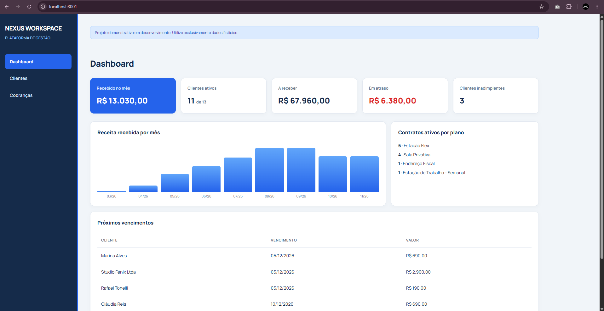
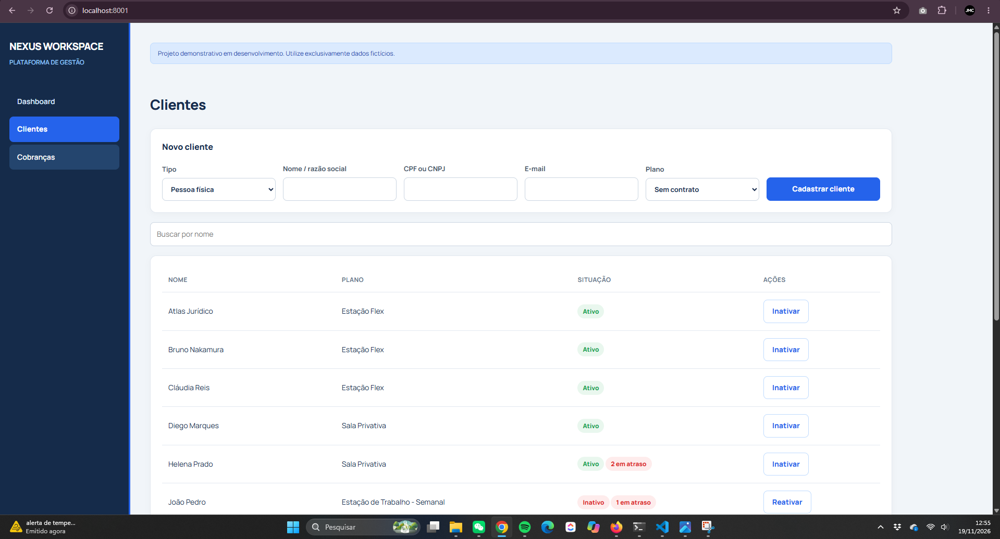
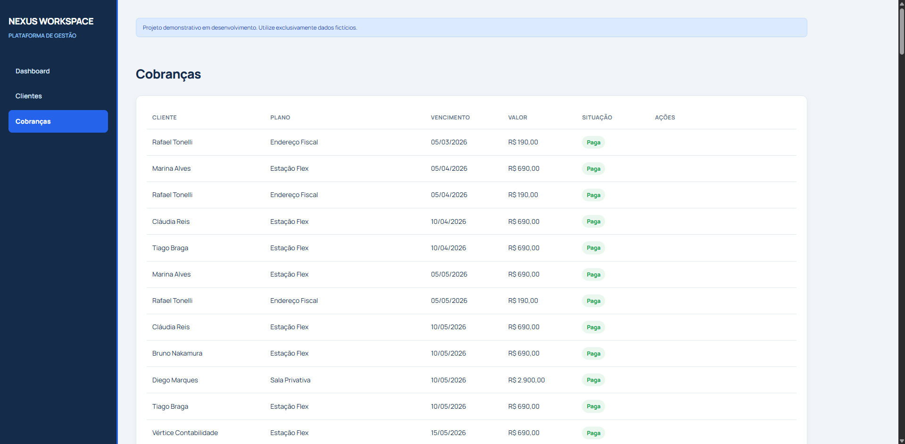
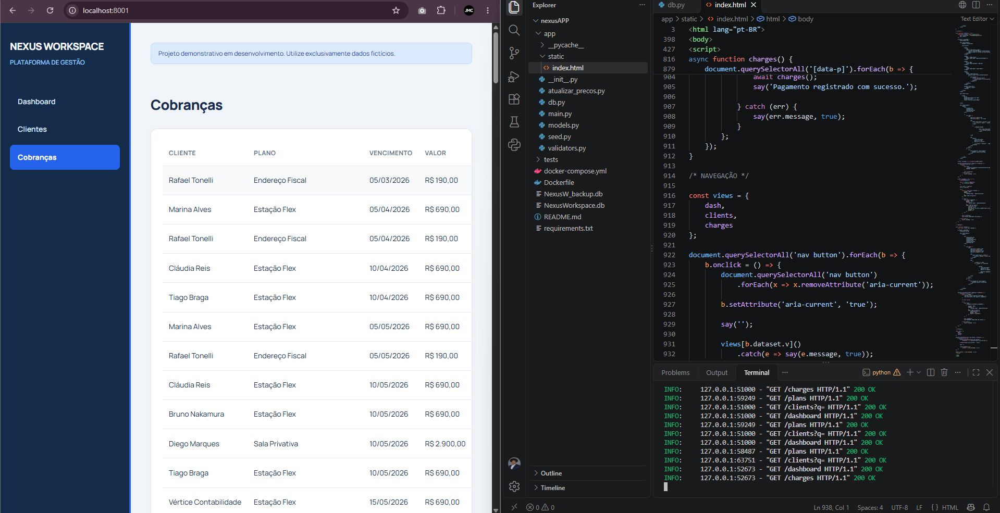

<div align="center">

# 🚀 NEXUS WORKSPACE

### Plataforma Web de Gestão Administrativa e Financeira

**Sistema desenvolvido com Python, FastAPI e tecnologias web.**

[](https://www.python.org/)
[](https://fastapi.tiangolo.com/)
[](https://developer.mozilla.org/pt-BR/docs/Web/HTML)
[](https://developer.mozilla.org/pt-BR/docs/Web/CSS)
[](https://developer.mozilla.org/pt-BR/docs/Web/JavaScript)
[](https://www.sqlite.org/)
[](https://www.docker.com/)

**Projeto demonstrativo | Desenvolvimento Full Stack | Portfólio**

</div>

---

## 📌 Sobre o Projeto

O **Nexus Workspace** é uma aplicação web de gestão administrativa e financeira, desenvolvida para centralizar informações de clientes, contratos, planos e cobranças em uma única plataforma.

O sistema apresenta uma interface moderna, organizada e intuitiva, permitindo visualizar indicadores financeiros e acompanhar diferentes operações administrativas.

O projeto foi criado para aplicar conhecimentos de desenvolvimento Full Stack, integração entre front-end e back-end, modelagem de dados e construção de APIs.

> ⚠️ **Aviso:** Este é um projeto demonstrativo em desenvolvimento. Todos os dados apresentados são fictícios e utilizados exclusivamente para fins educacionais e de portfólio.

---

## 🎯 Objetivos

- Centralizar informações administrativas.
- Facilitar o gerenciamento de clientes.
- Organizar planos e contratos.
- Acompanhar cobranças e vencimentos.
- Visualizar indicadores financeiros.
- Identificar situações de inadimplência.
- Desenvolver uma aplicação web com interface intuitiva.
- Aplicar boas práticas de desenvolvimento de software.

---

## 🖥️ Demonstração do Sistema

### 📊 1. Dashboard Administrativo

O dashboard oferece uma visão geral dos principais indicadores da plataforma.

**Informações apresentadas:**

- Valores recebidos no mês.
- Quantidade de clientes ativos.
- Valores a receber.
- Total de pagamentos em atraso.
- Quantidade de clientes inadimplentes.
- Gráfico de receitas mensais.
- Distribuição de contratos por plano.
- Próximos vencimentos.



---

### 👥 2. Gestão de Clientes

A plataforma disponibiliza uma interface para cadastro, consulta e gerenciamento de clientes.

**Funcionalidades apresentadas:**

- Cadastro de pessoas físicas e jurídicas.
- Campos para CPF ou CNPJ.
- Cadastro de nome ou razão social.
- Registro de e-mail.
- Associação de planos.
- Busca de clientes por nome.
- Visualização da situação cadastral.
- Ações para ativar e inativar clientes.
- Identificação de situações de atraso.



---

### 💳 3. Gestão de Cobranças

O módulo de cobranças permite acompanhar informações financeiras relacionadas aos clientes e seus respectivos planos.

**Informações disponíveis:**

- Nome do cliente.
- Plano contratado.
- Data de vencimento.
- Valor da cobrança.
- Situação do pagamento.
- Histórico de cobranças.



---

### 💻 4. Ambiente de Desenvolvimento

O Nexus Workspace utiliza uma arquitetura que integra uma interface web ao back-end desenvolvido em Python.

A imagem demonstra o ambiente de desenvolvimento no Visual Studio Code, com a aplicação em execução local e registros de requisições HTTP.



---

## 🛠️ Tecnologias Utilizadas

| Tecnologia | Utilização |
|------------|------------|
| 🐍 Python | Linguagem principal do back-end |
| ⚡ FastAPI | Desenvolvimento da API |
| 🌐 HTML5 | Estrutura da interface |
| 🎨 CSS3 | Estilização e responsividade |
| 💛 JavaScript | Interatividade e comunicação com a API |
| 🗄️ SQLite | Armazenamento de dados |
| 🐳 Docker | Configuração de ambiente em contêineres |
| 🧪 Pytest | Testes automatizados |
| 🔧 Git | Controle de versões |
| 🐙 GitHub | Hospedagem do código-fonte |

---

## 🏗️ Arquitetura do Projeto

A aplicação é organizada em componentes responsáveis pela interface, processamento das requisições e persistência dos dados.

**Front-end**

Desenvolvido com HTML, CSS e JavaScript, responsável pela apresentação dos dados e interação com o usuário.

**Back-end**

Desenvolvido com Python e FastAPI, responsável pelo processamento das requisições e pela disponibilização dos endpoints da aplicação.

**Banco de Dados**

Estrutura de persistência baseada em SQLite para armazenamento das informações utilizadas pelo sistema.

**Integração**

A comunicação entre a interface e o back-end ocorre por meio de requisições HTTP.

---

## 📂 Estrutura de Arquivos

```text
nexus-workspace/
│
├── app/
│   ├── __init__.py
│   ├── main.py
│   ├── db.py
│   ├── models.py
│   ├── seed.py
│   ├── validators.py
│   ├── atualizar_precos.py
│   │
│   └── static/
│       └── index.html
│
├── screenshots/
│   ├── dashboard.png
│   ├── clientes.png
│   ├── cobrancas.png
│   └── desenvolvimento.png
│
├── tests/
│   ├── __init__.py
│   └── test_app.py
│
├── Dockerfile
├── docker-compose.yml
├── requirements.txt
├── .gitignore
└── README.md
```

---

## ⚙️ Como Executar o Projeto

### 1. Pré-requisitos

É necessário ter instalado:

- Python 3
- Git
- Um navegador web
- Docker (opcional)

### 2. Clonar o Repositório

```bash
git clone https://github.com/jptragino-dev/nexus-workspace.git
```

### 3. Acessar a Pasta

```bash
cd nexus-workspace
```

### 4. Criar o Ambiente Virtual

```bash
python -m venv .venv
```

### 5. Ativar o Ambiente Virtual

No Windows PowerShell:

```powershell
.\.venv\Scripts\Activate.ps1
```

### 6. Instalar as Dependências

```bash
pip install -r requirements.txt
```

### 7. Inicializar a Aplicação

```bash
uvicorn app.main:app --reload --port 8001
```

> O comando acima pressupõe que a instância FastAPI esteja definida como `app` em `app/main.py`. Confirme essa configuração antes de executar.

### 8. Acessar o Sistema

Abra o navegador e acesse:

```text
http://localhost:8001
```

A documentação interativa da API, quando habilitada, pode ser acessada em:

```text
http://localhost:8001/docs
```

---

## 🐳 Docker

O repositório também possui arquivos de configuração para execução em contêineres.

Para iniciar os serviços definidos no Docker Compose:

```bash
docker compose up --build
```

A porta de acesso dependerá da configuração do arquivo `docker-compose.yml`.

---

## 🧪 Testes

O projeto possui uma estrutura de testes automatizados.

Para executar os testes com Pytest, caso esteja instalado:

```bash
python -m pytest
```

Os testes estão organizados no diretório:

```text
tests/
```

---

## 🔐 Segurança e Dados

O Nexus Workspace é um projeto demonstrativo.

Por esse motivo:

- Os dados apresentados nas imagens são fictícios.
- Bancos de dados locais não são incluídos no repositório.
- Arquivos de ambiente e informações sensíveis devem permanecer fora do controle de versão.
- A utilização em produção exige validação adicional de segurança, autenticação e infraestrutura.

---

## 🚀 Melhorias Futuras

Entre as possibilidades de evolução do projeto estão:

- [ ] Autenticação e controle de acesso.
- [ ] Diferentes níveis de permissão.
- [ ] Relatórios financeiros.
- [ ] Exportação de dados.
- [ ] Notificações de vencimento.
- [ ] Integração com serviços de pagamento.
- [ ] Ampliação dos testes automatizados.
- [ ] Implantação em ambiente de produção.
- [ ] Melhorias de acessibilidade e responsividade.

---

## 👨‍💻 Desenvolvedor

**João Pedro Moreira**

Estudante de Análise e Desenvolvimento de Sistemas (ADS).

Desenvolvedor em formação, com interesse em desenvolvimento Full Stack, automação de processos e construção de soluções web.

**GitHub:** [@jptragino-dev](https://github.com/jptragino-dev)

**Repositório:** [Nexus Workspace](https://github.com/jptragino-dev/nexus-workspace)

---

<div align="center">

### ⭐ NEXUS WORKSPACE

**Transformando conhecimentos em soluções práticas.**

Projeto desenvolvido para fins educacionais, aprendizado e portfólio profissional.

</div>
